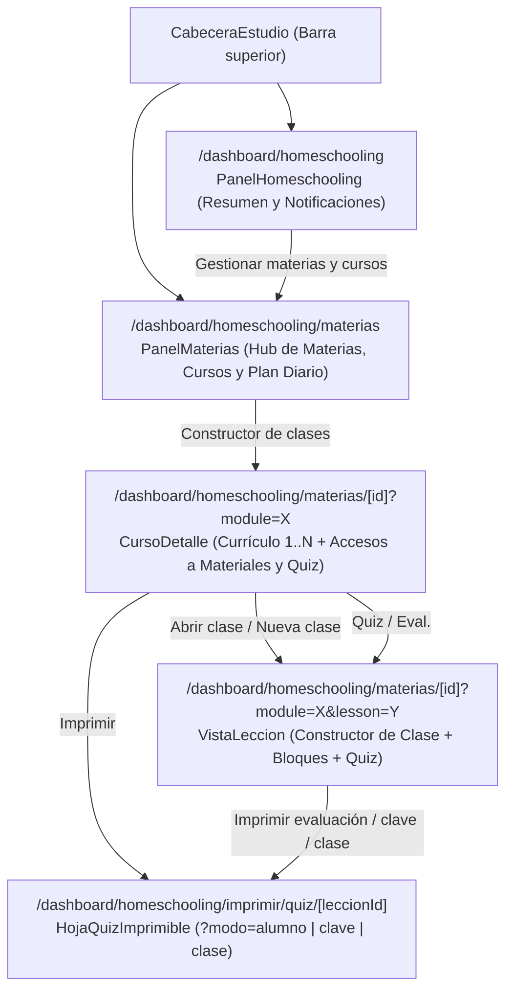

# Lane 230 — Panel «Materias», Constructor Multimodal de Clases y Evaluaciones Imprimibles

> **Fecha**: 2026-10-16 / 2026-10-17
> **Rama integrada**: `task/lane-230-materias-constructor-clases` → `dev`

---

## 1. Pedido del usuario

1. **Nuevo panel «Materias»** (`/dashboard/homeschooling/materias`) en Estudios donde se gestionen materias, cursos, lecciones/clases, materiales de estudio (enlaces, libros, videos, imágenes, textos, documentos descargables) y evaluaciones.
2. **Panel principal de Resumen y Notificaciones** (`/dashboard/homeschooling`): dejar el inicio de Estudio enfocado en indicadores del día, notificaciones/avisos, alertas de repaso, resumen semanal y seguimiento diario por hijo.
3. **Carga rica de materiales de estudio** (tanto en el Plan de Estudio como en los Cursos/Clases): permitir cargar textos con formato, imágenes, archivos descargables (PDF, ePub, documentos Office/texto), videos embebidos y enlaces web.
4. **Constructor de Clases y Cursos (estilo Circle / Thinkific, enfocado en tareas)**:
   - Orden secuencial clase por clase (`1..N`).
   - Posibilidad de que cada clase combine varios tipos de contenido (video embebido + texto/descripción con formato + imagen/lámina + documentos descargables + evaluación) o sea de un único tipo de contenido (solo tarea escrita, solo video, solo lámina, solo archivo descargable o solo evaluación).
5. **Quizzes y Assessments visibles e imprimibles en A4**:
   - Hacer visible y directo dónde crear/editar Quizzes y Evaluaciones (Assessments) tanto desde el listado del curso como dentro del constructor de cada clase.
   - Permitir imprimir los Quizzes, Assessments y Clases en hoja A4 (versión para el alumno sin respuestas, clave de corrección para padres con respuestas y explicaciones, y hoja de clase completa).

---

## 2. Arquitectura y flujo funcional

### 2.1 Separación entre «Panel» y «Materias»
- **`CabeceraEstudio.tsx`**:
  - En `PADRE`, se agregó la pestaña **Materias** (`/dashboard/homeschooling/materias`, ícono `BookOpen`) inmediatamente después de **Panel** (`/dashboard/homeschooling`).
  - La pestaña **Panel** queda activa únicamente en la raíz `/dashboard/homeschooling` para padres, mientras que **Materias** se activa tanto en `/dashboard/homeschooling/materias` como dentro de `/dashboard/homeschooling/materias/[id]`.
- **Panel Principal (`src/app/dashboard/homeschooling/page.tsx` + `PanelHomeschooling.tsx`)**:
  - Carga en servidor `misAvisos(actor, 15)` además de `avisosParaPadre`, `estadisticasEvidencias`, `resumenPanel` y `resumenSemanal`.
  - Muestra:
    1. **4 tarjetas KPI**: *Clases de hoy*, *Para revisar*, *Clases atrasadas* y *Notificaciones*.
    2. **Centro de notificaciones y atención requerida**: entregas pendientes de revisión, alertas de repaso FSRS/quizzes fallados y lista interactiva de `AvisoEstudio` con botón **«Marcar avisos como leídos»** (`POST /api/homeschooling/notificaciones`).
    3. **Resumen semanal** (`ResumenSemanal`).
    4. **Hoy por alumno**: progreso general, clases del día, acceso al plan y botón *Ponerse al día* si hay atrasos.
    5. **Tarjeta de acceso rápido al panel Materias**.
- **Panel «Materias» (`src/app/dashboard/homeschooling/materias/page.tsx` + `PanelMaterias.tsx`)**:
  - Totales de contenido activo (*Materias activas*, *Cursos*, *Clases y materiales*, *Quizzes / Evaluaciones*).
  - Acciones globales en cabecera:
    - **Cargar material al plan diario**: abre un `Sheet` donde se elige alumno y fecha y se cargan materiales multimodales con `ListaMaterial`.
    - **Asignar curso al plan** (`AsistenteCurso`).
    - **Nueva materia** (`MateriaForm`).
    - **Nuevo curso** (`CursoForm`), que al guardarse redirige directo al constructor del curso (`/dashboard/homeschooling/materias/[id]?module=[cursoId]`).
  - Tarjetas por materia con botones para **Biblioteca Católica**, **Importar curso (JSON)** y **Nuevo curso**, listando cada curso con contadores de **clases**, **materiales** y **quizzes/evaluaciones**, barra de avance y botón **Constructor de clases**.
  - Sección de **Materias archivadas** con restauración en 1 clic.

---

### 2.2 Sistema de archivos y Materiales de Estudio multimodales

#### Backend de subida y descarga (`Archivo`)
- **`src/lib/archivos.ts`**:
  - `claveDeUrl(url)` reconoce opcionalmente query strings en `/api/archivos/<uuid>?...` (por ejemplo `?tipo=pdf` o `?descargar=1`).
  - `guardarArchivoEstudio(file)` admite:
    - **Imágenes** (`image/*` hasta 10 MB): se comprimen a WebP (máx. 1600 px) igual que el resto de imágenes de Ordo.
    - **Documentos de estudio** (`.pdf`, `.epub`, `.doc`, `.docx`, `.odt`, `.txt`, `.md`, `.csv`, `.xls`, `.xlsx`, `.ppt`, `.pptx` hasta 4 MB): se almacenan en la tabla `Archivo` conservando `mime` y `nombreOrigen`, devolviendo `/api/archivos/<uuid>?tipo=<tipo>` sin requerir migraciones destructivas ni cambios en `prisma/schema.prisma`.
  - `leerArchivo(clave)` incluye `nombreOrigen`.
- **`src/app/api/upload/route.ts`**:
  - Cuando el `FormData` envía `modo="estudio"`, delega en `guardarArchivoEstudio(file)` y devuelve `{ url, tipo, mime, nombre }`.
- **`src/app/api/archivos/[clave]/route.ts`**:
  - Cuando recibe `?descargar=1`, agrega el encabezado `Content-Disposition: attachment; filename="..."` usando el `nombreOrigen` sanitizado.
- **`src/lib/subirImagen.ts`**:
  - Exporta `subirArchivoEstudio(file)` para subir imágenes o documentos desde cualquier formulario de Estudio.

#### Detección, visualización e impresión de materiales
- **`src/lib/homeschooling/material.ts`**:
  - Nuevo proveedor `"imagen"` en `PROVEEDORES_MATERIAL` y helper `esImagenMaterial(m)`.
  - `esEnlace`, `detectarMaterial`, `vistaMaterial` y `esImprimible` reconocen rutas internas `/api/archivos/<uuid>` y permiten imprimir láminas/imágenes además de textos, Markdown, PDFs y Google Docs.
- **`src/components/homeschooling/material/AgregarMaterial.tsx`**:
  - Modal con **5 pestañas de tipo de contenido**:
    1. **Texto / Tarea**: editor con barra de formato Markdown (`## Subtítulo`, `**Negrita**`, `*Cursiva*`, `- Lista`) y conmutador **Editar / Vista previa**.
    2. **Imagen**: subida desde el dispositivo o URL de imagen con vista previa inmediata.
    3. **Video**: enlace de YouTube, Vimeo o archivo `.mp4`/`.webm` con reproductor embebido en vivo.
    4. **Archivo / Libro**: subida de PDF, ePub o documento desde el dispositivo o enlace de Google Drive / Google Docs.
    5. **Enlace web**: cualquier sitio o recurso externo.
- **`src/components/homeschooling/material/ListaMaterial.tsx` y `VisorMaterial.tsx`**:
  - Botones de alta rápida por tipo (`+ Texto / Tarea`, `+ Imagen`, `+ Video embebido`, `+ Archivo / Libro`, `+ Enlace`).
  - Prop `expandido`: cuando se usa dentro del constructor de clases (`VistaLeccion`) o del panel de materiales, despliega en línea las imágenes, videos embebidos y bloques de texto/Markdown en el orden de la clase.
  - Botones de vista en pantalla completa (`VisorMaterial`), impresión con control de cupo (`BotonImprimir`) y descarga directa (`?descargar=1`).

---

### 2.3 Constructor de Clases y Cursos (estilo Circle / Thinkific)

- **`CursoForm.tsx`**:
  - Los cursos nuevos seleccionan por defecto el tipo **`enlaces` («Curso por clases y tareas», `unidad: "leccion"`)** para habilitar inmediatamente el armado clase por clase, e incluyen el campo **Umbral de aprobación (%)** para los quizzes/evaluaciones.
- **`CursoDetalle.tsx`**:
  - Muestra siempre la sección **Constructor de clases y evaluaciones (1..N)**.
  - Cada fila de clase ofrece accesos directos para:
    - **Materiales** (`Paperclip`): abre el `Sheet` con `ListaMaterial` expandida para esa clase.
    - **Quiz / Eval.** (`ClipboardCheck`): abre `EditorPreguntas` directamente desde el currículo del curso.
    - **Imprimir** (`Printer`): abre la versión imprimible A4 en una pestaña nueva.
    - **Editar** (`Edit2`) y flechas para **reordenar** (`ArrowUp` / `ArrowDown`).
- **`LeccionForm.tsx` («Constructor de clase — Nueva clase / Editar clase»)**:
  - Permite armar una clase de un solo tipo de contenido o combinando todos:
    - **Título de la clase o evaluación**.
    - **Tarea, lectura o descripción de la clase** (hasta 5000 caracteres, con barra Markdown y vista previa).
    - **Imagen o lámina de la clase** (`PortadaCampo` → `miniaturaUrl` en `LeccionCurso`).
    - **Video embebido, archivo descargable o enlace** (con subida directa de documentos mediante `subirArchivoEstudio` y vista previa de video).
  - Incluye el botón **«Guardar y configurar Quiz / Evaluación»**, que guarda la clase y abre inmediatamente `EditorPreguntas`.
- **`VistaLeccion.tsx` (Constructor de clase a página completa)** y **`VisorLeccion.tsx` (Visor del alumno)**:
  - Renderizan el video embebido o tarjeta de documento descargable, la imagen propia de la clase y la consigna en Markdown.
  - En `VistaLeccion.tsx`, el padre dispone en la misma pantalla de:
    1. **Bloques de contenido y materiales descargables de la clase** (`ListaMaterial` con `expandido={true}`).
    2. **Quiz y Evaluación (Assessment)** con la lista de preguntas configuradas, indicando cuál es la opción correcta y si alguna pregunta es un *checkpoint* de video, junto a los botones **Crear / Editar preguntas**, **Imprimir evaluación (Alumno)** e **Imprimir clave (Padre)**.

---

### 2.4 Quizzes, Evaluaciones (Assessments) y Clases Imprimibles en A4

- **Ruta**: `/dashboard/homeschooling/imprimir/quiz/[id]?modo=alumno|clave|clase` (`src/app/dashboard/homeschooling/imprimir/quiz/[id]/page.tsx`).
- **Componente**: `src/components/homeschooling/quiz/HojaQuizImprimible.tsx`.
- **Seguridad**: si quien accede no es Padre/Madre (`!esPadre`), el servidor verifica que el alumno tenga un `PlanCurso` en ese curso, excluye materiales marcados como `soloPadres` y nunca envía `correcta` ni `explicacion` al cliente (forzando `modo` a `alumno` o `clase`).
- **3 formatos de impresión A4** (conmutables desde la barra superior antes de imprimir):
  1. **Evaluación (Alumno)** (`?modo=alumno`): encabezado formal con Materia, Curso, Título de la evaluación, recuadro `Calificación: ___ / 100` y umbral de aprobación, campos `Alumno/a:` y `Fecha:`, consigna opcional, preguntas numeradas con círculos de opción (`◯ A)`, `◯ B)`…), interruptor para agregar renglones de justificación/desarrollo escrito y pie de observaciones.
  2. **Clave de respuestas (Padre)** (`?modo=clave`): marca la opción correcta (`✓ Correcta`) y muestra la explicación pedagógica debajo de cada pregunta.
  3. **Hoja de clase completa** (`?modo=clase`): imprime en una sola hoja A4 la consigna de la clase, la imagen/lámina de la clase, todos los bloques de lectura/imágenes adjuntos y el cuestionario de evaluación.

---

## 3. Archivos creados y modificados

| Archivo | Cambio |
|---|---|
| `src/app/dashboard/homeschooling/materias/page.tsx` | **Nuevo**: página servidor del panel «Materias». |
| `src/components/homeschooling/cursos/PanelMaterias.tsx` | **Nuevo**: componente principal de gestión de materias, cursos, constructor de clases y material para el plan diario. |
| `src/app/dashboard/homeschooling/imprimir/quiz/[id]/page.tsx` | **Nuevo**: página servidor para imprimir Quizzes, Assessments y Clases completas en A4. |
| `src/components/homeschooling/quiz/HojaQuizImprimible.tsx` | **Nuevo**: vista de impresión A4 con modos *Evaluación (Alumno)*, *Clave de respuestas* y *Hoja de clase completa*. |
| `src/components/homeschooling/nav/CabeceraEstudio.tsx` | Agrega pestaña **Materias** para padres y separa el estado activo respecto de **Panel**. |
| `src/app/dashboard/homeschooling/page.tsx` | Carga `misAvisos` y los entrega al panel principal. |
| `src/components/homeschooling/plan/PanelHomeschooling.tsx` | Transformado en **Panel de Resumen y Notificaciones** (KPIs, centro de avisos y alertas, resumen semanal y estado diario por hijo). |
| `src/lib/homeschooling/servidor/panel.ts` | Calcula por cada curso la cantidad de clases (`lecciones`), `materiales` y `quizzes`. |
| `src/lib/archivos.ts` | Agrega `guardarArchivoEstudio`, soporte de query params en `claveDeUrl` y `nombreOrigen` en `leerArchivo`. |
| `src/app/api/upload/route.ts` | Soporta `modo="estudio"` para subir imágenes y documentos descargables. |
| `src/app/api/archivos/[clave]/route.ts` | Soporta `?descargar=1` con `Content-Disposition: attachment`. |
| `src/lib/subirImagen.ts` | Agrega helper cliente `subirArchivoEstudio(file)`. |
| `src/lib/homeschooling/material.ts` | Proveedor `"imagen"`, helper `esImagenMaterial`, detección e impresión de `/api/archivos/<uuid>`. |
| `src/lib/homeschooling/material.test.ts` | Tests unitarios para `/api/archivos/<uuid>` de imágenes y PDFs subidos. |
| `src/lib/homeschooling/servidor/impresiones.ts` | Permite generar token de hoja impresa para materiales de imagen. |
| `src/components/homeschooling/material/HojaImpresion.tsx` | Renderiza láminas/imágenes en la hoja A4 de material. |
| `src/components/homeschooling/material/AgregarMaterial.tsx` | Rediseñado con 5 pestañas (*Texto/Tarea* con Markdown, *Imagen*, *Video*, *Archivo/Libro*, *Enlace*). |
| `src/components/homeschooling/material/ListaMaterial.tsx` | Botones rápidos por tipo, vista expandida en línea, descarga directa e impresión con `BotonImprimir`. |
| `src/components/homeschooling/material/VisorMaterial.tsx` | Renderiza imágenes en el visor y botón de descarga para archivos subidos. |
| `src/app/api/homeschooling/_comun.ts` | `datosLeccion` acepta `miniaturaUrl`. |
| `src/lib/homeschooling/servidor/cursos.ts` | `crearLeccion` y `editarLeccion` admiten `miniaturaUrl` y enlaces `/api/archivos/...`. |
| `src/lib/homeschooling/roost/services/group.ts` | `RecordingInsert` envía `thumbnail_url` como `miniaturaUrl`. |
| `src/components/homeschooling/cursos/CursoForm.tsx` | Predetermina cursos por clases/tareas (`enlaces` / `leccion`) y permite editar `umbral_aprobacion`. |
| `src/components/homeschooling/cursos/CursoDetalle.tsx` | Muestra siempre el constructor de clases con botones *Materiales*, *Quiz / Eval.* e *Imprimir* en cada clase. |
| `src/components/homeschooling/cursos/LeccionForm.tsx` | Constructor multimodal de clase (Markdown, imagen, video embebido, documento descargable y botón *Guardar y configurar Quiz*). |
| `src/components/homeschooling/cursos/VistaLeccion.tsx` | Vista completa de la clase con bloques `ListaMaterial` expandidos y sección de Quiz/Assessment imprimible. |
| `src/components/homeschooling/cursos/EditorPreguntas.tsx` | Botones para *Guardar e imprimir evaluación* e *Imprimir clave* + callback `onGuardado`. |
| `src/components/homeschooling/cursos/MateriaLayout.tsx` | Conecta el editor de Quiz desde el listado del curso, desde el alta de clase y desde la vista de la clase; migas con `Materias`. |
| `src/lib/homeschooling/servidor/hoy.ts` | Incluye `miniaturaUrl` en `LeccionHoy`. |
| `src/components/homeschooling/hoy/VisorLeccion.tsx` | Muestra al alumno la imagen de la clase, botón de descarga de documentos y consigna renderizada en Markdown. |
